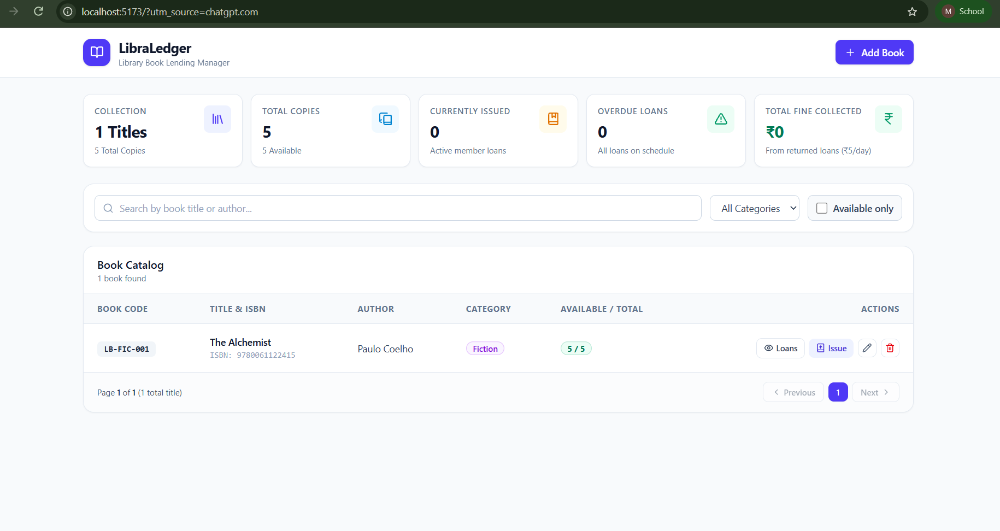
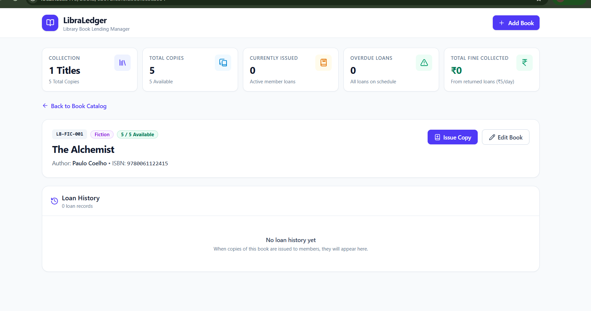

# LibraLedger — Library Book Lending Manager (MERN Stack)

A full-stack Library Book Lending Manager built with MongoDB Atlas, Express.js, React.js, and Node.js. Librarians can manage book collections, issue copies to members with automatic 14-day due dates, process returns with automatic late fine calculation (₹5/day), view loan history with overdue detection, and track real-time library statistics.

## Project Structure

```text
library-book-lending-manager/
├── backend/
│   ├── config/db.js
│   ├── controllers/
│   ├── models/
│   ├── routes/
│   ├── tests/
│   ├── utils/
│   ├── .env
│   ├── app.js
│   ├── package.json
│   └── server.js
├── frontend/
│   ├── src/
│   │   ├── api/
│   │   ├── components/
│   │   ├── pages/
│   │   ├── utils/
│   │   ├── App.jsx
│   │   └── main.jsx
│   ├── .env
│   ├── index.html
│   ├── package.json
│   └── vite.config.js
└── README.md
```

## Setup & Running Locally

### 1. Configure Environment Variables
Update `backend/.env` with your MongoDB Atlas connection string:
```env
PORT=5000
MONGO_URI=mongodb+srv://<username>:<password>@<cluster-url>.mongodb.net/library_lending_manager?retryWrites=true&w=majority&appName=Cluster0
CLIENT_ORIGIN=http://localhost:5173
```

`frontend/.env` points to the backend API:
```env
VITE_API_URL=http://localhost:5000/api
```

### 2. Install Dependencies & Start Backend
```bash
cd backend
npm install
npm run dev
```

### 3. Install Dependencies & Start Frontend
```bash
cd frontend
npm install
npm run dev
```

### 4. Run Backend Tests
```bash
cd backend
npm test
```

---

## REST API Endpoints

All responses follow the consistent JSON format:
```json
{
  "success": true,
  "message": "...",
  "data": {}
}
```

| Method | Endpoint | Description | Status Codes |
| :--- | :--- | :--- | :--- |
| `GET` | `/api/health` | Health check endpoint | `200` |
| `GET` | `/api/stats` | Get library statistics (`totalTitles`, `totalCopies`, `copiesIssued`, `overdueLoans`, `totalFineCollected`) | `200`, `500` |
| `GET` | `/api/books` | List books with pagination (`limit=5`), `page`, `category`, `availableOnly`, and `search` (title or author) | `200`, `400` |
| `POST` | `/api/books` | Add a new book (validates ISBN 10/13 digits, copies 1–20, auto-generates `LB-CAT-###`, rejects duplicate ISBN) | `201`, `400`, `409` |
| `GET` | `/api/books/:id` | Get a single book's details and full loan history with computed `isOverdue` | `200`, `400`, `404` |
| `PUT` | `/api/books/:id` | Edit `title`, `author`, and `totalCopies` (immutable `bookCode`, `isbn`, `category`; recalculates `availableCopies`) | `200`, `400`, `404` |
| `DELETE` | `/api/books/:id` | Delete a book (rejected if any copy is currently issued) | `200`, `400`, `404` |
| `POST` | `/api/books/:id/issue` | Issue a copy to a member (defaults to today, rejects future date, rejects 0 available, rejects duplicate active loan per member/book, sets 14-day due date) | `201`, `400`, `404`, `409` |
| `GET` | `/api/books/:id/loans` | Get loan history for a book with `isOverdue` flag | `200`, `400`, `404` |
| `POST` | `/api/loans/:loanId/return` | Return an active loan (sets return date to today, increments `availableCopies`, calculates fine at ₹5/day late) | `200`, `400`, `404` |
| `PATCH` | `/api/loans/:loanId/return` | Alias for returning an active loan | `200`, `400`, `404` |

---

## Screenshots

> Add 2 screenshots of the running application in `docs/screenshots/` once connected to MongoDB Atlas:
> 1. `docs/screenshots/dashboard.png` — Dashboard with Statistics Cards, Filters, and Book Catalog
> 2. `docs/screenshots/loan-history.png` — Book Details & Loan History with Status/Overdue Badges and Return Action



